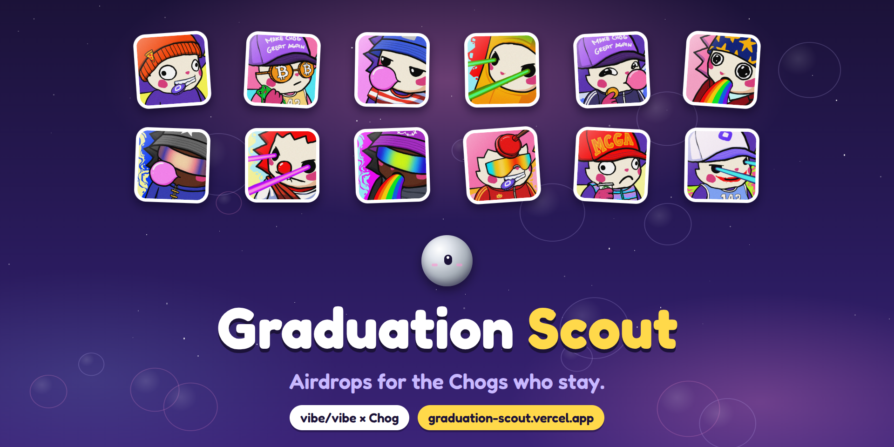
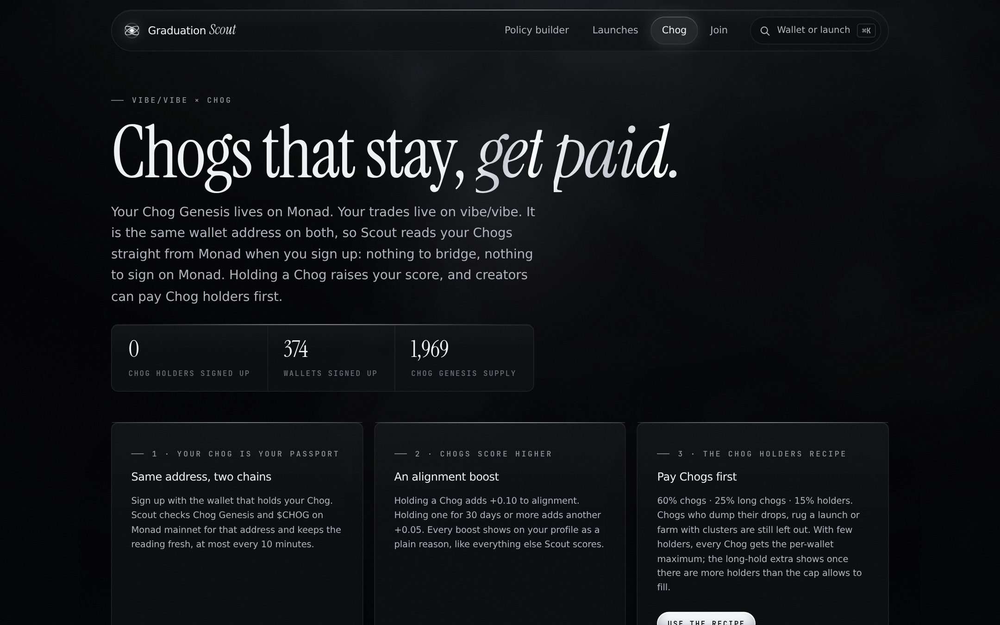
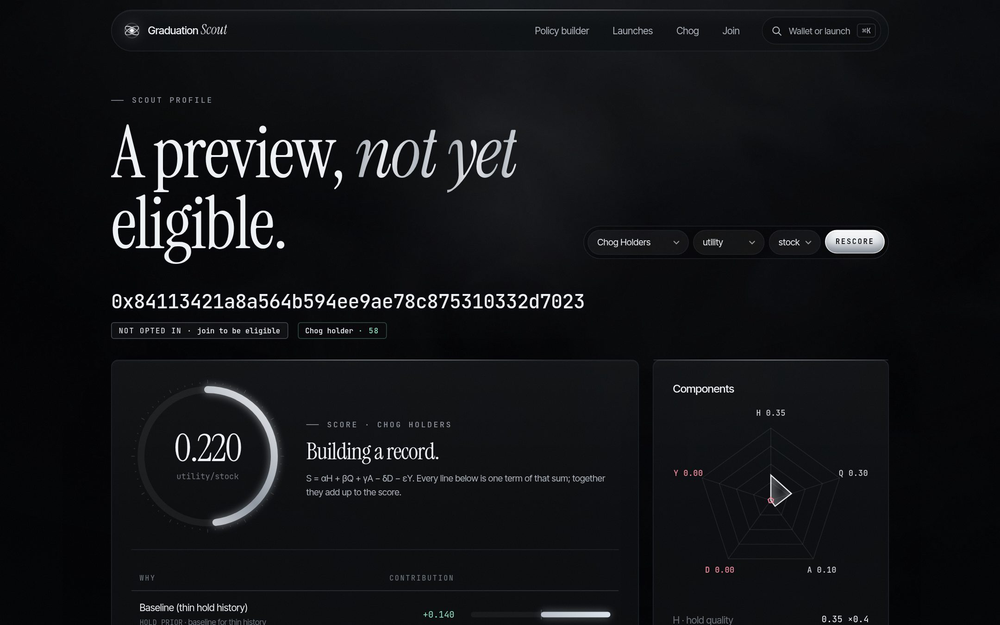
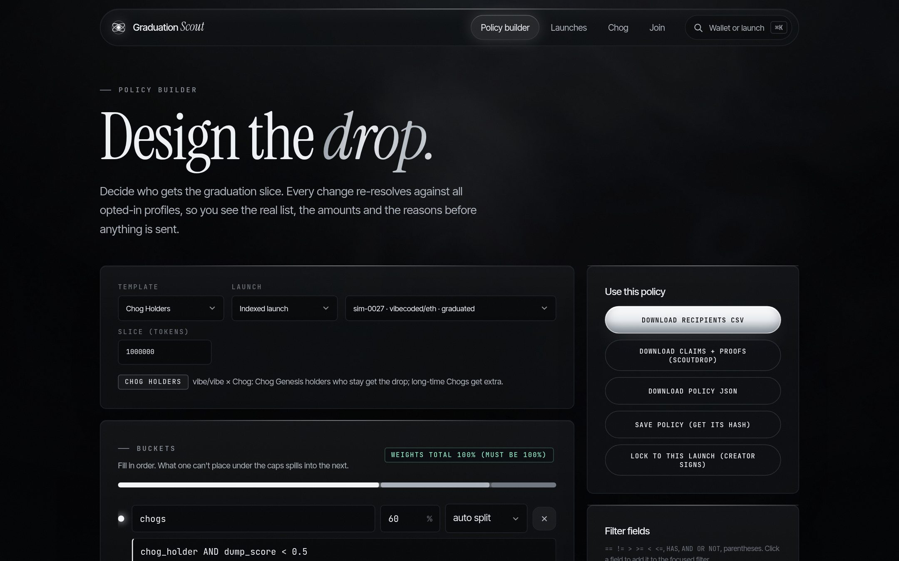
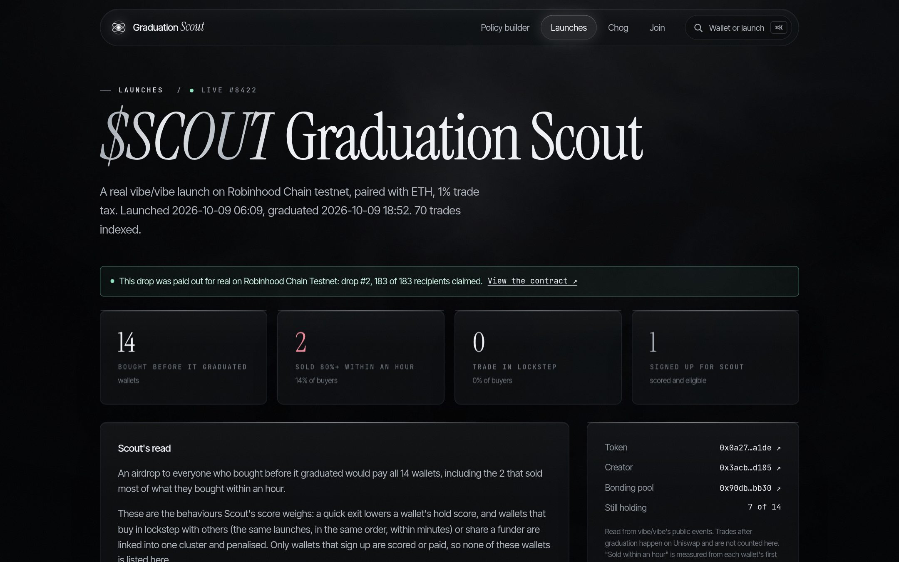

# Graduation Scout



**Airdrops for the ones who stay.**

Built for the Chogathon (vibe/vibe × Chog). Live on Robinhood Chain testnet, reading Chogs from Monad mainnet:
**<https://graduation-scout.vercel.app>** · five minute walkthrough in [docs/JUDGES.md](docs/JUDGES.md).

---

## The problem

When a token graduates on [vibe/vibe](https://vibevibe.fun), its creator can airdrop a slice of the supply to their
community. In practice that slice goes to whoever bought first. On one real vibe/vibe launch, **70 of the first 100
buyers sold most of what they bought within an hour.** A snapshot airdrop pays all 70, and the wallet farms that
split one buyer into twenty get twenty shares.

The holders a creator actually wants, the people who keep what they are given, look the same as everyone else on a
holder list. Nothing on the list says who held the last drop, who dumped it in an hour, or which twenty wallets are
one person.

## What Graduation Scout is

1. **A profile for every wallet that opts in.** One signed message, no gas. Scout scores the wallet from what it did
   on chain: whether it held past earlier airdrops, what it trades, whether it sells drops within the hour, and
   whether it moves in lockstep with other wallets. Every score lists its reasons.
2. **A Chog passport.** Chog Genesis lives on Monad and vibe/vibe trading lives on Robinhood Chain, and a wallet has
   the same address on both. Scout reads a member's Chogs straight from Monad. Holding a Chog raises the score, and
   holding one for 30 days raises it again.
3. **Recipes for creators.** A creator picks a recipe or writes one: who qualifies, how the slice is split, the caps
   per wallet and per cluster, who is excluded. The Chog Holders recipe pays Chogs first. The creator can lock the
   recipe to the launch before it graduates, so it can't be changed once the result is known.
4. **A sealed payout.** At graduation Scout resolves the recipe into a list of wallets and amounts with a Merkle root,
   and the ScoutDrop contract pays it out on chain. Anyone can resolve again the recipe and check the root.
5. **An aftermath.** After the drop Scout measures who held and who sold at 1 hour, 24 hours, 7 days and 30 days.
   Those numbers feed every later score, so each drop makes the next one fairer.

## Product tour

Captured from the production site.

**Home.** What Scout does, with live counts and a two minute guided tour.


**The Chog page.** How the Chog passport works, the Chog Holders recipe, and every signed up Chog holder.



**A profile.** A real Chog holder's wallet, read from Monad on the spot: the Chog chip, the score with every reason,
and the recipes the wallet qualifies for.



**The builder.** Pick a recipe and a launch, edit the rules, and watch the list of recipients resolve live. Export
the CSV, the claims with proofs, or the policy, or lock it to the launch.



**$SCOUT on vibe/vibe.** Our own token, launched and graduated on vibe/vibe, with Scout's read of its buyers and the
real drop it paid.



## Trying it

[**docs/JUDGES.md**](docs/JUDGES.md) is the five minute walkthrough. Most of the site needs no wallet. Joining needs
one free signature, with no gas and no network switch.

## Documentation

| | |
|---|---|
| [`docs/JUDGES.md`](docs/JUDGES.md) | Five minute walkthrough for judges |
| [`docs/CHOG.md`](docs/CHOG.md) | The Chog integration: passport, score boosts, recipe, sync |
| [`docs/SCORING.md`](docs/SCORING.md) | The scoring model, the policy language and how a policy resolves |
| [`docs/EVALUATION.md`](docs/EVALUATION.md) | How Scout scores a simulated season where every wallet's behaviour is known |
| [`docs/ONCHAIN.md`](docs/ONCHAIN.md) | The ScoutDrop contract, the showcase drop and the $SCOUT drop |
| [`docs/DATA.md`](docs/DATA.md) | Live vibe/vibe indexing, the aftermath job and the SPARK snapshot |
| [`docs/WEB.md`](docs/WEB.md) | Pages, JSON API, settings, browser tests and design |
| [`docs/VERIFICATION.md`](docs/VERIFICATION.md) | The prelaunch verification pass: every bug found and every known limit |
| [`docs/DEPLOY.md`](docs/DEPLOY.md) | Hosting the site on Vercel with Postgres |
| [`video/README.md`](video/README.md) | The launch film, the Chog edition and "Hold Your Chog" |
| [`docs/posts/`](docs/posts) | The X thread, the Discord post and the demo script |

## Repository layout

```
packages/core        Scoring, sybil clustering, policy language, resolver, Merkle tree
packages/db          Postgres schema, migrations, writers, the WalletFacts loader
packages/sources     vibe/vibe on Robinhood Chain, Chog on Monad, SPARK on Base, the simulated world
packages/contracts   ScoutDrop (Solidity), ABI, claim batches, local test chain
apps/indexer         The scout CLI: index, simulate, resolve, evaluate, pay out, sync Chogs
apps/web             Next.js site and JSON API
video/               Motion graphics built in code with Remotion
docs/                Walkthrough, design notes, verification
  brand/             Cover image
  screens/           Product screenshots
  posts/             X thread, Discord post, demo script
```

Data flows one way. A source emits normalized records, the writer stores them, the loader turns them into
`WalletFacts` as of a point in time, and the engine scores those. Adding a chain means adding a source.

## Running it

```bash
pnpm install
pnpm scout simulate      # seed the simulated world into a local database
pnpm web                 # builds the packages, then http://localhost:3000
```

Node 22 or newer and pnpm 10. Without `DATABASE_URL`, everything runs on [PGlite](https://pglite.dev), Postgres
compiled to WebAssembly, so there is nothing else to install.

## Status

| Component | State |
|---|---|
| Scoring engine: scores, reasons, sybil clustering, policies, resolver, Merkle tree | Built, 69 tests passing |
| Data layer: schema, migrations, WalletFacts loader, Chog status | Built, 10 tests passing |
| ScoutDrop contract: create, claim, batch claims, sweep | Built, 7 tests passing. Not audited |
| Sources: vibe/vibe decoders against recorded receipts, Chog reader, SPARK snapshot, simulator | Built, 18 tests passing |
| Indexer: every recipe checked at five graduations against handwritten rules, on chain loop | Built, 19 tests passing |
| Web service: sign up, linking, profiles, builder, exports, locks, Chog reads | Built, 18 tests passing |
| Site in a real browser: sign up with a real signature, linking, builder, aftermath, tour, phone, Chog page | 8 flows passing |
| Live vibe/vibe indexing from Robinhood Chain testnet | Running in production |
| ScoutDrop on Robinhood Chain testnet | Two drops paid, every claim delivered |
| Chog passport on Monad mainnet | Running in production |

141 unit and integration tests and 8 browser flows, all passing. The verification pass and every bug it found are in
[docs/VERIFICATION.md](docs/VERIFICATION.md).

## The numbers that make the case

**Our own drop, on chain.** $SCOUT launched on vibe/vibe (launch #8422) and graduated on 9 October 2026. Scout
resolved the Hold or Die recipe as of that moment and ScoutDrop paid **8,930,000 SCOUT to 183 wallets**. All 183
claimed, and an independent second resolution gives the same Merkle root and policy hash that are sealed on chain:
[transaction](https://explorer.testnet.chain.robinhood.com/tx/0xf13bd23a93964ec9ab7aded3773a573adfbe3c89ef6ef71ed82d45554018699c).

**Farms get almost nothing.** Every recipe was resolved at all 43 graduations of the simulated season, where the
farms are known:

| Recipe | Share of all tokens to farm wallets |
|---|---|
| Hold or Die | 0.46% |
| Custom | 0.44% |
| Builder Lane | 0.77% |
| Stock Pair Natives | 0.94% |
| SPARK Core | 1.75% |

No honest wallet was penalised as a farm at any of the 43 graduations.

**Holding a Chog pays.** With 248 simulated Chog holders under the Chog Holders recipe, Chogs held for 30 days or
more averaged **5,000 tokens** and newer Chogs **3,772**. Dumpers, rug creators and farms received nothing.

Reproduce the first two with `pnpm scout evaluate --ignore-hubs 20` and the indexer test suite.

## Local development

```bash
pnpm install
pnpm test          # every package, on in-process Postgres
pnpm typecheck
pnpm build
pnpm e2e           # builds the site, then runs the browser flows
```

Independent builder project. Not affiliated with vibe/vibe, Spark Labs or Chog.
